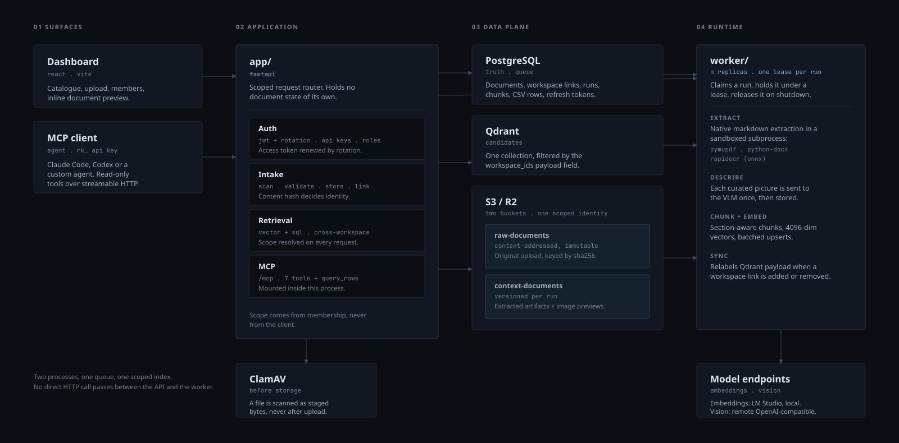

# Retriv

Retriv is a workspace-scoped document backend. It accepts PDF, DOCX, PPTX, XLSX and
CSV files,
extracts and indexes their contents, and exposes the result to people through a
dashboard API and to agents through an MCP server.

```
PDF / DOCX  ->  chunks + embeddings  ->  semantic search and in-order reading
CSV         ->  SQL rows             ->  aggregation and filtered queries
any file    ->  object storage       ->  signed download addresses
```

Every answer is scoped to the workspaces the caller belongs to. A document is
deduplicated by content, not by workspace: the same bytes uploaded to two
workspaces stay one object with one pipeline, one chunk set, and one vector set.

For the detailed internals — data model, pipeline stages, retrieval rules, MCP
tools, RLS and storage layout — read [`app/README.md`](app/README.md).

## Demo

https://github.com/user-attachments/assets/c53184dc-f194-43c2-8a77-1cc1083f8834

47 seconds, 1920×1080, no audio.

An administrator creates a workspace and hands it to an owner, the owner drops
in a financial report, the pipeline forks — PDF, DOCX and PPTX become embedded
chunks, CSV becomes SQL rows — and an agent connected over MCP asks a question
and answers it with a citation.

Rendered with Remotion. The video is a motion recreation of the dashboard, not a
screen recording. The same clip is committed at
[`docs/media/retriv-promo.mp4`](docs/media/retriv-promo.mp4) with
[`retriv-promo-poster.jpg`](docs/media/retriv-promo-poster.jpg) beside it.

## Architecture

There is one API process, one worker process, one database, and the external
services the deployment provides: object storage, embeddings, and vision.



*Two processes, one queue, one scoped index. Source:
[`docs/images/retriv-architecture.svg`](docs/images/retriv-architecture.svg);
object storage and model endpoints are external services.*

The API answers requests. The worker does the expensive, untrusted part: native
markdown extraction (PyMuPDF, python-docx and a RapidOCR ONNX engine) in a
sandboxed subprocess, chunking, and embedding writes. Replicas claim
work through a lease on the run row, so `--scale worker=N` is how you add
capacity; there is no direct HTTP call between the two processes.

| Component | Short role |
|---|---|
| Dashboard | Workspace catalogue, uploads, members, inline PDF and Word preview. |
| MCP client | Claude Code, Codex or a custom agent using read-only tools. |
| `app/` | Auth, document intake, scoped retrieval, and the MCP server on `/mcp`. |
| PostgreSQL | Canonical documents, workspace links, runs, chunks, CSV rows, embedding vectors, refresh tokens. |
| S3 / R2 | Two buckets: `raw-documents` (content-addressed uploads) and `context-documents` (per-run artifacts and image previews). |
| `worker/` | Sandboxed native extraction, chunking and embedding writes. |
| ClamAV | Scans the staged bytes before anything is stored. |
| Model endpoints | LM Studio for embeddings (local); an OpenAI-compatible VLM for picture descriptions. |

## Core concepts

### Workspace

A workspace is the unit of access. Users join through `workspace_memberships`
with one of three roles:

| Role | Can read | Upload | Download | Delete | Manage members |
|---|---:|---:|---:|---:|---:|
| `owner` | yes | yes | yes | yes | yes |
| `editor` | yes | yes | yes | yes | no |
| `viewer` | yes | no | no | no | no |

`admin` is a platform role for user and workspace administration. It does not
grant access to workspace documents.

### Canonical document and workspace links

`documents` is one row per content hash. `document_workspaces` is the link table
that decides who can see it.

```
                 +----------------------+
                 | documents            |
                 | id (canonical)       |
                 | sha256 (unique)      |
                 | origin_workspace_id  |
                 +----------+-----------+
                            |
              +-------------+-------------+
              |                           |
    +---------v----------+     +----------v---------+
    | document_workspaces|     | processing_runs    |
    | workspace_id       |     | chunks / vectors   |
    | filename           |     | rows / artifacts   |
    | deleted_at         |     +--------------------+
    +--------------------+
```

What that means in practice:

- **One upload, one pipeline.** Uploading the same bytes to a second workspace
  creates a link; it does not upload the object again or re-run extraction.
- **One chunk set, one vector set.** Chunks and embeddings belong to the
  canonical document. They are not duplicated per workspace.
- **A filename per workspace.** The same content can be `report.pdf` in Finance
  and `q4-results.pdf` in Legal.
- **Delete is a link operation.** Removing one workspace's link leaves the
  document available to the others. The canonical row, object, chunks and
  vectors are removed only when the last link goes away.
- **One status.** The processing run is shared; a failed or ready document is
  failed or ready in every workspace that links to it.

### Processing

An upload creates a processing run. The worker claims queued runs from
PostgreSQL with a lease, fetches the raw object, extracts it, chunks and embeds
it, and marks the run ready. Failures are retried with backoff; a lease that
expires is reclaimed by the next worker. The run is the only source of document
status.

PDF and DOCX become chunks and vectors. CSV becomes rows in PostgreSQL and is
queried with SQL; it is never embedded. Pictures inside documents are described
by an optional multimodal model and the description is folded into the chunk
that held the picture.

### Retrieval

- `search_context` embeds the question and runs one scoped SQL search over the
  pgvector index inside the caller's workspace scope, optionally narrowed to a
  single document.
- `search_text` matches literal words inside the same scope, for identifiers,
  article numbers and names that an embedding resolves only approximately.
- `read_document` reads chunks by `ordinal`, which answers “what comes after
  this” where a vector search cannot.
- `get_document_outline` lists a document's sections with the ordinal and page
  each starts at, so a long document is entered at the right place.
- `list_workspaces` names the workspaces the credential can read, with roles
  and document counts.
- `describe_document` reports what extraction produced (pages, chunks, images,
  rows) and the pipeline's last error, separating “the document does not say”
  from “the document was never extracted”.
- `query_rows` runs model-written SQL under a read-only role and PostgreSQL
  row-level security.
- `download_document` returns a short-lived signed object-store link and a
  permission-checked API URL; the bytes never pass through the model context.

The search reads workspace scope from the `document_workspaces` table at query
time, so a link change needs no vector work; the small job the change queues
just acknowledges it.

## Document lifecycle at a glance

1. **Upload.** The file is staged, scanned, validated and hashed.
2. **Link or store.** If the hash already exists, the target workspace gets a
   link. Otherwise the raw object is stored once and a processing run is queued.
3. **Process.** The worker extracts, chunks and embeds PDF/DOCX, or stores CSV
   rows for SQL. One run per canonical document.
4. **Use.** Search, read in order, query CSV rows, or mint a download address.
   Every result is checked against the caller's live workspace access.
5. **Delete.** Removing a workspace link hides it only there. The last unlink
   queues cleanup of the object, chunks and vectors.

## Quickstart

### Prerequisites

- Docker Engine and Docker Compose v2.
- `uv` for local test/lint, or Python 3.12+.
- An OpenAI-compatible embedding server reachable from the worker container.
- An OpenAI-compatible multimodal endpoint for picture descriptions. Set
  `RETRIV_IMAGE_PROCESSING_ENABLED=false` to skip this stage.
- An S3-compatible object-store account. Cloudflare R2 is the reference
  provider; AWS S3 and other S3-compatible services are supported.
- About 4 GiB of RAM for ClamAV.

### Object storage

Create two buckets before starting the stack:

- `raw-documents` — original uploads;
- `context-documents` — extracted artifacts and manifests.

Create two R2 API tokens:

| Token | Permission | Buckets |
|---|---|---|
| API | `Object Read & Write` | raw only |
| Worker | `Object Read & Write` | raw + artifact |

The API token uploads and signs downloads. The worker token reads raw objects
and writes artifacts. R2 scopes permissions per bucket and cannot express
prefix-level policies; that is why the worker token is scoped to both buckets.

### Configuration and run

```bash
cp .env.example .env
# Fill in object storage, database, JWT, embedding and vision settings.
```

The example file lists every variable and the R2/AWS choices. At minimum, set
the object-store endpoint, region, both token pairs, both bucket names, and the
first admin credentials.

```bash
make worker      # build and start the extraction worker
make migrate     # start infrastructure and apply migrations
make api         # run the API on http://127.0.0.1:9000
```

The dashboard is a separate npm project:

```bash
cd web && npm ci && npm run dev
```

It runs at `http://127.0.0.1:9500`.

`make api` reuses the worker image already built. After changing worker code,
run `make worker` or `make run-build` first. Object storage is external: no
MinIO service runs locally.

## Security

- Dashboard users authenticate with a short-lived HS256 JWT; MCP clients use a
  long-lived `rk_...` API key.
- The JWT carries `auth_version`. Password rotation and bootstrap-admin changes
  bump it, revoking outstanding tokens on the next request.
- Workspace access is checked from live memberships on every request, never
  from a caller-supplied workspace id.
- API keys are read-only and reach only `/mcp` and the document download route.
- Uploaded files are scanned by ClamAV before storage. Encrypted PDFs and
  macro-enabled Office files are rejected.
- Vector search results are validated rows of PostgreSQL itself; the vector
  index is an ordering over the same rows the ledger vouches for.
- PDF/DOCX extraction runs in a sandboxed subprocess with memory, process,
  file-size and time limits.

## Repository map

| Path | What it is |
|---|---|
| `app/` | FastAPI API, MCP server, retrieval, storage and processing orchestration |
| `worker/` | the extraction worker process |
| `alembic/` | schema migrations |
| `web/` | the dashboard |
| `tests/` | unit and PostgreSQL integration tests |
| `docker/` | one-shot Postgres init scripts |
| `compose.yaml` | local PostgreSQL (pgvector), ClamAV and worker |

Detailed app documentation: [`app/README.md`](app/README.md).

## Operations

- Apply schema changes with `alembic upgrade head` (or `make migrate`).
- The worker image contains a copy of `app/`; rebuild it after changing any
  shared code with `make worker`.
- Vectors live in PostgreSQL (pgvector); the whole schema arrives as a single
  baseline migration.
- Health: `GET /health/live` is liveness; `GET /health/ready` checks PostgreSQL
  (the pgvector extension included), object storage and ClamAV.
- Tracing: with `RETRIV_TRACING_ENABLED=true` both processes export OTLP spans
  to the Jaeger container (`docker compose up -d jaeger`); the UI is at
  `http://localhost:16686`. One trace per request on the API, one per claimed
  run on the worker (`process.run` → `extract` → `describe` → `embed`, plus
  SQL, HTTP and S3 child spans). The extraction sandbox is never traced — it
  has no network; its cost shows in the worker's `extract` span. Set
  `RETRIV_TRACING_ENABLED=false` to turn it off.

## Development

```bash
make test     # pytest
make check    # pytest + ruff + mypy
```

Tests that need a real PostgreSQL server are skipped unless
`TEST_POSTGRES_URL` is set.
