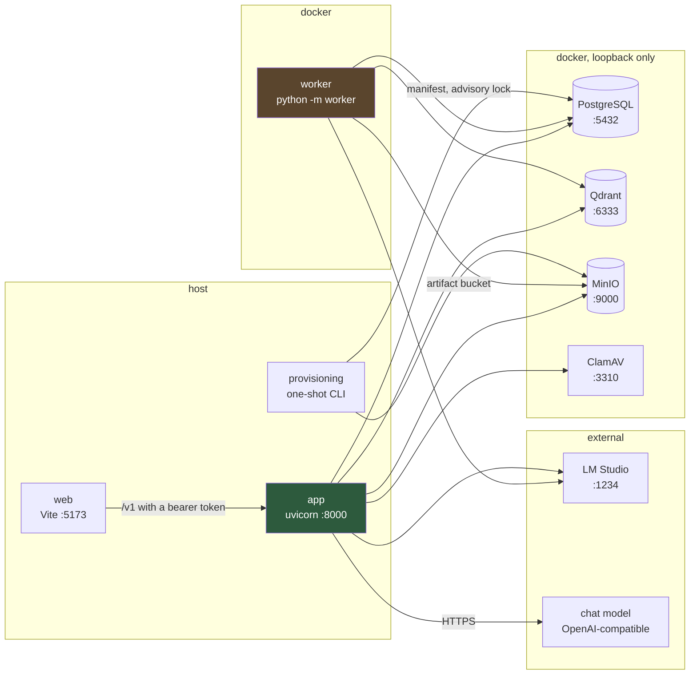
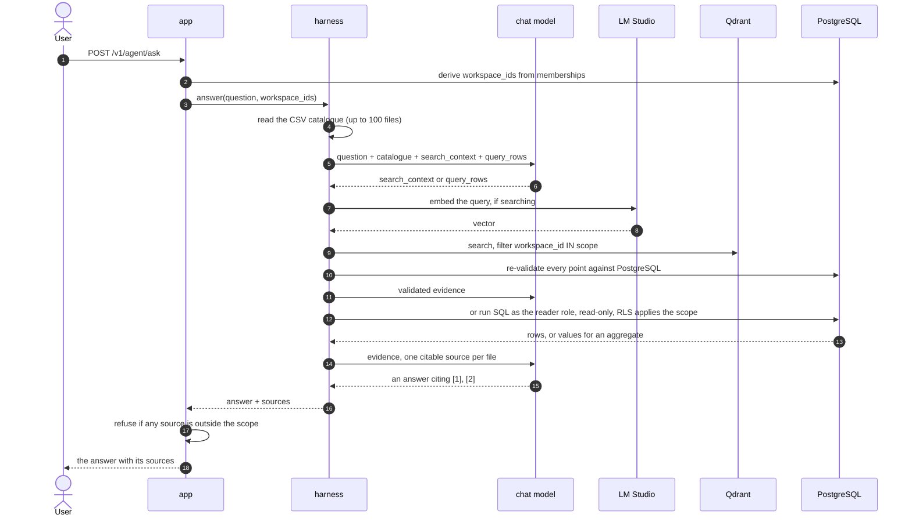
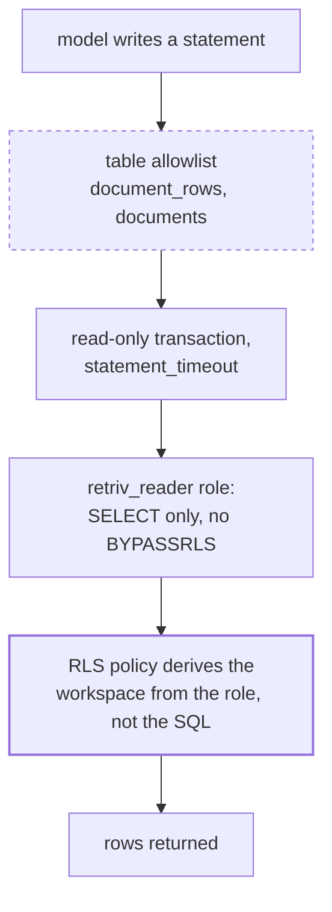
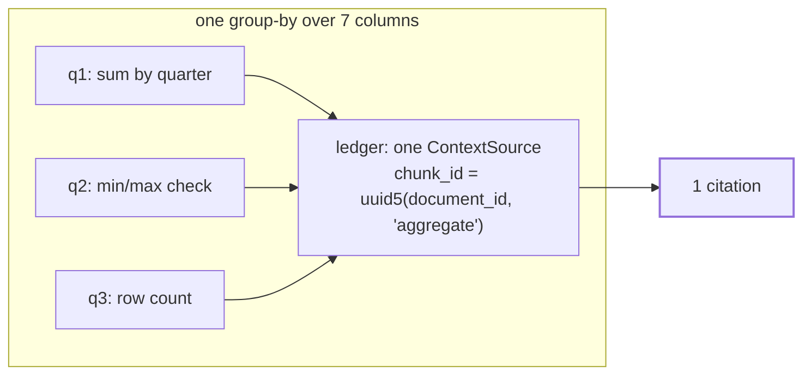
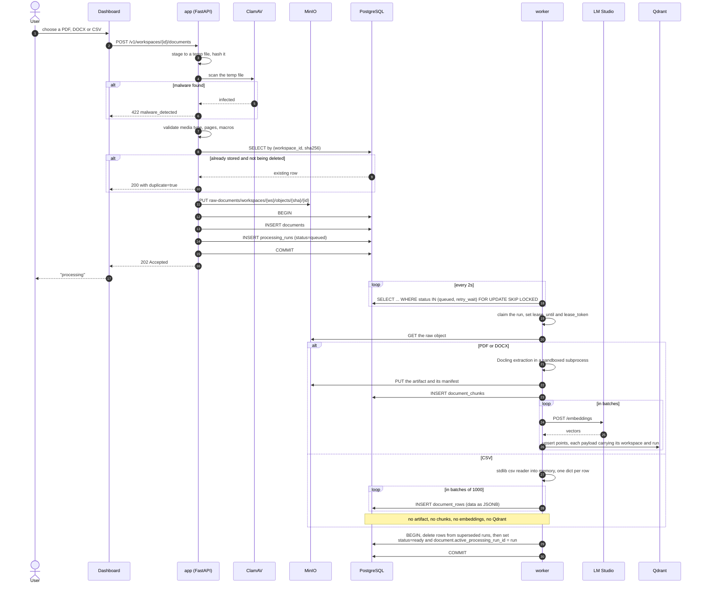
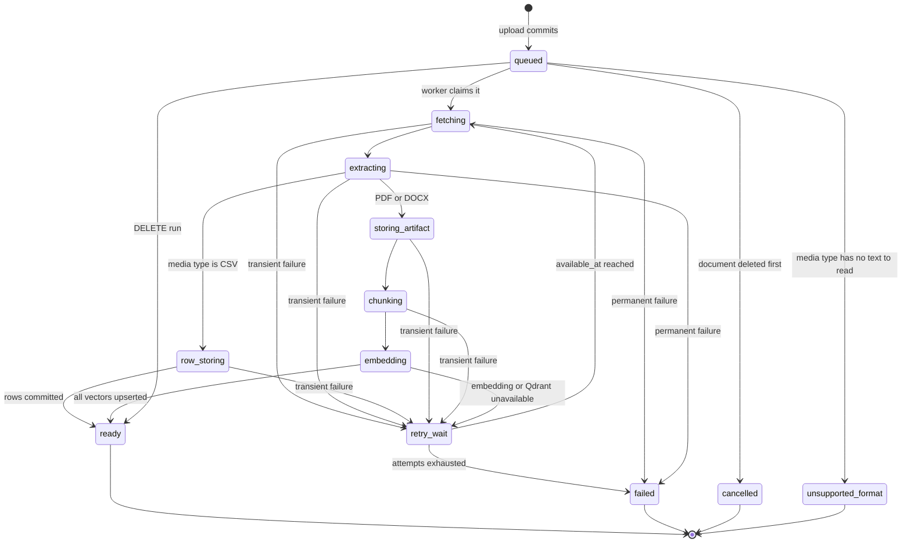
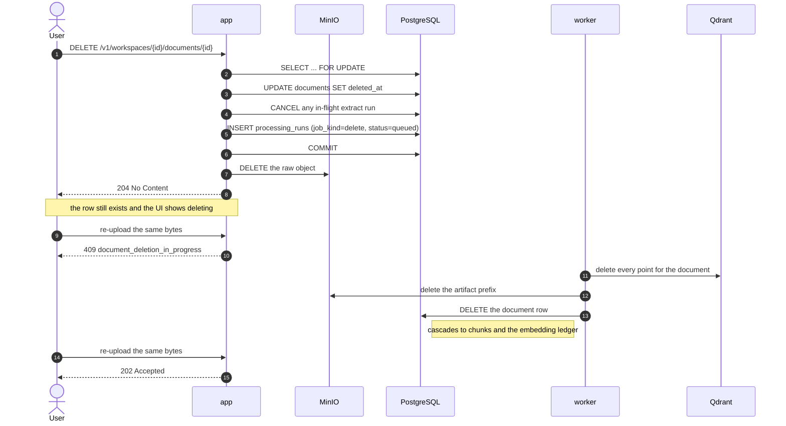
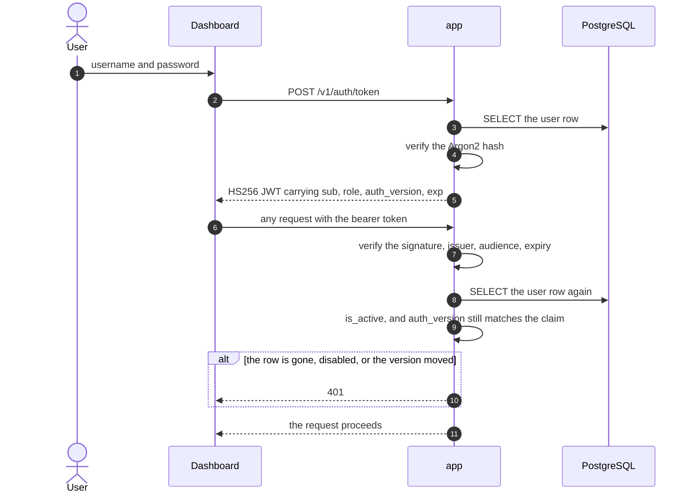
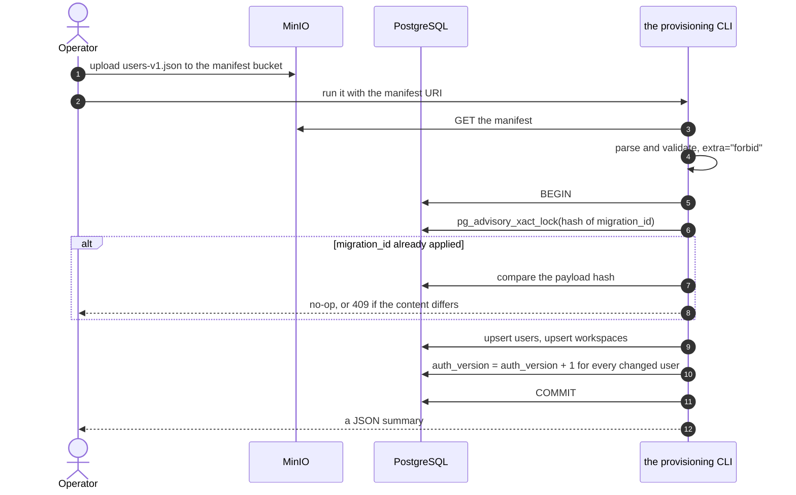
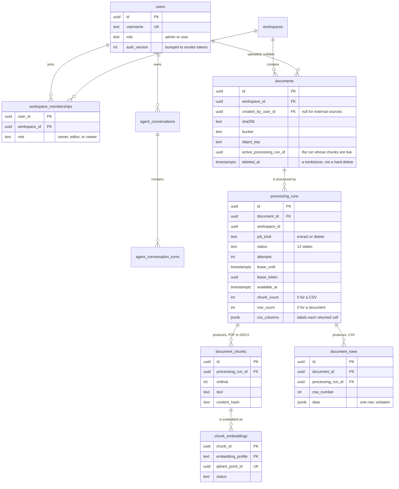

# Retriv

Backend untuk menerima dokumen perusahaan dengan scope per workspace, mengindeksnya, dan
menjawab pertanyaan di atasnya.

Satu aplikasi. Satu database. Dua entrypoint lain: worker pemrosesan dan provisioning.

```
app/          the HTTP application: auth, documents, processing status, answers
worker/       the extraction worker: Docling, chunking, embedding (separate process)
provisioning/ the one-shot CLI that creates the first users and workspaces
alembic/      one migration history, one database
web/          the dashboard
```



Solid arrows are the only thing crossing a process boundary now, and all of them point
at infrastructure. The three application processes reach each other through `app/`'s own
imports.

## Why one application

It used to be three services with their own databases, talking over HTTP. That bought a
lot of machinery for no benefit: a shared token, an HMAC-signed webhook, a transactional
outbox, an event inbox, an RS256 scope keypair, and a read-only database role — all to let
one process call another on the same host. Roughly sixteen environment variables whose
only job was to prove the caller was who it said it was.

The answer path is still scoped. A question is answered only from workspaces the caller
has `search_context` on, and the retriever re-checks that against every Qdrant point and
every PostgreSQL row. What changed is that the scope is now a function argument derived
from the caller's own memberships, rather than a token that had to be signed and
verified.

The worker stays a separate process for a concrete reason: Docling and PyTorch need
about 1.7 GB, an 8 GiB parser memory cap, and a sandboxed subprocess per document. Keeping
that in its own container is what keeps the API image around 250 MB and keeps a hostile
PDF away from the request path.

## Scope

- JWT access tokens valid for 60 minutes.
- The first users are created by a one-shot provisioning manifest; later users by a
  platform admin.
- `admin` is a platform role for the dashboard and grants no workspace data access.
- Workspace access lives in a membership table with role `owner`, `editor`, or `viewer`.
- Every authenticated user can see the workspace catalogue; document data requires a
  matching membership.
- Identical bytes in the same workspace are deduplicated by SHA-256.
- Uploads default to 50 MiB and 500 pages; encrypted and macro-enabled documents are
  rejected, and ClamAV scans before anything is stored.
- `PDF` and `DOCX` are chunked and embedded. `CSV` is stored as rows and queried with
  SQL; it is never embedded. `XLSX` is not accepted at all, because nothing could read
  it.
- A document's status is derived from its active processing run. There is no status
  column, so the document and the pipeline cannot disagree.

## Prerequisites

- Docker Engine and Docker Compose v2.
- `uv` for local test/lint, or Python 3.12+.
- An OpenAI-compatible embedding server on `127.0.0.1:1234` that is reachable from the
  worker container.
- A chat API key for answers, and the model id to use with it. The endpoint
  need not be OpenRouter: the harness picks `OpenRouterModel` or `OpenAIChatModel` from
  `CHAT_BASE_URL`, so any OpenAI-compatible service works.
- About 4 GiB of RAM for ClamAV on first startup.

## Running locally

```bash
cp .env.example .env
```

Fill in every `CHANGE ME`. The only one that cannot be generated for you is the chat
key; the rest are `openssl rand -hex 32`. Until the chat key and model are set, uploads
and indexing work and questions return a provider error.

```bash
make migrate   # start infrastructure and apply the schema
make api       # start the worker, then run the API on :8000
```

`make api` builds and starts the worker in Docker, so the first run takes a while: the
image is ~1.7 GB and the Docling layout and tableformer models are downloaded into it.

The dashboard is a separate npm project:

```bash
cd web && npm ci && npm run dev
```

It is at `http://127.0.0.1:5173`.

ClamAV's first start downloads its signature database and can take a few minutes.
PostgreSQL, Qdrant, MinIO, and ClamAV publish on loopback only.

## Data

Everything is in Docker named volumes under the `retriv-api` project:

- `retriv-api_postgres_data`
- `retriv-api_qdrant_data`
- `retriv-api_minio_data`
- `retriv-api_clamav_data`

Nothing is bind-mounted. `docker compose down` keeps the data; `docker compose down -v`
deletes all of it.

## Asking a question

A turn has two possible doors into the documents. `search_context` retrieves prose by
meaning; `query_rows` runs SQL over tabular rows. The model is offered both and picks,
which is why the catalogue is in every prompt it sees.



Four things keep this honest, and all four survive the merge:

1. **The scope is derived from the caller's own membership table**, not from a
   client-supplied list. There is no signed token to forge, because there is no second
   service to receive one.
2. **The `search_context` tool accepts a query and nothing else.** A model has no
   argument with which to argue for a wider scope.
3. **Every Qdrant point is re-validated against PostgreSQL**, including a recomputed
   `content_hash`. A vector whose chunk is gone, stale, or from a superseded run never
   reaches the model.
4. **The route re-checks the sources on the way out.** Reaching that check means the
   harness itself drifted, so the whole answer is refused rather than returned in part.

A turn that cited a workspace the caller has since lost stays visible in their private
transcript, but its sources are blanked and it is never replayed as context. Greeting-only
messages skip retrieval entirely, so a user with no workspace can still say hello.

### Asking a spreadsheet question

`query_rows` is a different door into the data, and it is worth being precise about what
protects it. The statement is written by the model, so it is not the argument validation
that keeps it in bounds — four layers below it do:



The dashed layer is the weakest one and is not what isolates anything. Deleting the
allowlist would not let the model read a table it lacks a grant on; the model cannot
issue `SET`, cannot open a transaction, and cannot write. What the allowlist does remove
is a table that is *granted* but should not be *mentioned* — `processing_runs` carries
`lease_token` and `last_error`, so the wrapper reads it to learn a file's columns while
the model cannot name it at all.

`verify_reader()` refuses to run if the configured role turns out to be `SUPERUSER` or to
hold `BYPASSRLS`, which would make every layer above irrelevant.

The role is set up by migration `0003_row_catalogue`, which grants `SELECT` on the three
tables a query legitimately needs and enables `FORCE ROW LEVEL SECURITY` on all of them.
Point `SQL_DATABASE_URL` at that role, not at the application DSN: the tool works against
a full-privilege connection, but then nothing below is doing any work. Leaving the setting
unset is the safe default — the tool is never registered and the model cannot reach a
table, while the catalogue still lists the files through the app's own session so it can
tell the user the data exists but is not queryable.

Two rules keep a query from silently answering a question about the wrong file. A query
must mention a `document_id` literal, and rows returning more than one `document_id` are
rejected. Aggregates return no rows, so they are exempt from the second check and the
literal check is the only guard — a query using `ANY(array[...])` over two ids would
slip past it. That gap is real and still open; a fix would parse the id out of the
statement rather than searching its text.

### How a CSV answer is cited

An aggregate has no row to point at, so it cannot be cited the way a quoted line is. It
is cited against **the file it was computed from**, once:



The constant namespace is the point. A group-by that returns seven rows is still one
piece of evidence, and emitting a source per computed row filled the citation list with
twenty-one entries for the same file — most of them from the model checking its own
arithmetic. Two different files still yield two citations, which is correct: they are
different evidence.

The locator follows from the same rule. A source is located by page if it has one, by
row if it has one, and by nothing at all if it has neither — which is the case for every
aggregate and for every DOCX chunk, since Docling emits no `page_no` for DOCX. The older
"Page unavailable" string described a document kind rather than a fault, so it named the
wrong thing for every source that lacked pages.

## How a document becomes searchable



A CSV takes the rows path, not the chunk path. It is tabular data the model will
aggregate rather than prose it will quote, so it is stored verbatim as JSONB and
queried with SQL. Nothing is embedded, which is why the run reports `row_count = 320`
rather than a chunk count.

A document cannot exist without a way to be processed: the row and the run commit
together or not at all. There is no outbox and no retry-on-replay, because there is no
network hop where an event could be lost.

The run is not a signal — the worker **polls** every 2 seconds. `LISTEN`/`NOTIFY` was
rejected on purpose: the payload limit is 8 KB, the notification is delivered at commit
and is lost forever with no reader, so you would end up running both mechanisms anyway.

### The run state machine



A lease is held for 30 minutes and heartbeated every third of that. A run whose lease
expired is reclaimed by the next worker, which is what makes a worker crash recoverable
without a coordinator. Transient failures back off exponentially, capped at 300s.

## Deleting a document

The ordering is the whole point.



The Qdrant point IDs live in `chunk_embeddings`, which cascades away with the document.
Deleting the row first would orphan every vector the document ever produced, with no
record of where to find them. So the row outlives the request and dies last.

While the cleanup is in flight the `(workspace_id, sha256)` unique constraint still
holds the row, which is why an identical re-upload is refused rather than silently
creating a duplicate.

## Asking a question about a document


Four things keep this honest, and all four survive the merge:

1. **The scope is derived from the caller's own membership table**, not from a
   client-supplied list. There is no signed token to forge, because there is no second
   service to receive one.
2. **The `search_context` tool accepts a query and nothing else.** A model has no
   argument with which to argue for a wider scope.
3. **Every Qdrant point is re-validated against PostgreSQL**, including a recomputed
   `content_hash`. A vector whose chunk is gone, stale, or from a superseded run never
   reaches the model.
4. **The route re-checks the sources on the way out.** Reaching that check means the
   harness itself drifted, so the whole answer is refused rather than returned in part.

A turn that cited a workspace the caller has since lost stays visible in their private
transcript, but its sources are blanked and it is never replayed as context. Greeting-only
messages skip retrieval entirely, so a user with no workspace can still say hello.

The three tool limits are one budget, and the evidence a turn can actually hold is
`min(MAX_CURRENT_SOURCES, MAX_TOOL_CALLS * (max_context_chunks + heading_expand_chunks))`.
The second term binds first, so raising the source ceiling alone does nothing. A test
asserts the inequality so the two cannot drift apart silently.

## Authentication and revocation



`auth_version` is the reason a password reset or a provisioning change takes effect
immediately rather than at token expiry: the claim is compared against the row on every
request, so bumping the counter invalidates every outstanding token at once. The
`admin` platform role is orthogonal to workspace roles and grants no data access.

## Provisioning



It reads the manifest over S3, using the read-only `migration-reader` identity that
`minio-init` creates. That identity cannot reach `raw-documents` or
`context-documents`, so a manifest you have not reviewed cannot read your documents.

```bash
uv run --env-file .env -- python -m provisioning
```

The `--env-file` is required and not optional politeness: the job's settings class sets
`env_file=None`, so it reads the environment and nothing else. A one-shot with write
access to every user row should not silently pick up credentials because it ran in this
directory. Its variables carry a `PROVISIONER_` prefix and are in `.env.example`.

Two things to know before you use it:

- **It creates workspaces with no members.** Assigning the first owner is an admin API
  call: `PUT /v1/admin/workspaces/{id}/members/{user_id}`. A provisioned workspace is
  otherwise unreachable.
- **It overwrites credentials.** A username that already exists has its password hash,
  role, and active flag reset from the manifest, and its `auth_version` bumped, so every
  live session for that user is signed out.

## The shape of the data



`documents.status` does not exist. It is derived from `active_processing_run_id`'s run,
in one function, which is why the document and the pipeline cannot disagree.

A document has either `document_chunks` or `document_rows`, never both, and the run
carries the count that says which: `row_count = 320` for a CSV, `chunk_count = 412` for
a PDF. `csv_columns` sits on the run rather than on every row because it labels each
returned cell, and repeating a header across 100k rows is the cost this design avoids.

`document_rows.data` is JSONB and read with `->>`, which is why a SQL error saying
`column "year" does not exist` comes back to the model as a hint naming `data->>'Year'`
rather than as a failure. The harness translates the error rather than replaying it,
because the model can fix the second query and cannot fix a bare failure.

## Development

```bash
make check     # pytest, ruff, mypy
```

`tests/test_postgres_integration.py` covers the things SQLite cannot show —
concurrent identical uploads racing on a unique constraint, foreign-key ordering, RLS
against a real `retriv_reader`, and the full CSV path from HTTP upload through storage
and the worker to a queryable row. It skips unless `TEST_POSTGRES_URL` is set.

Two tests there currently fail and are unrelated to CSV: the concurrent-upload race can
observe a rolled-back duplicate, and one assertion still expects `RUN_CHUNKING` where the
worker now sets `RUN_EMBEDDING` directly.

Tests here are checked by mutation as well as by passing. A test that stays green when
the behaviour it names is reverted is worse than no test, so the citation rules in
particular are verified by reverting each one — a per-row `chunk_id`, `section_path`
repopulated with column names, a dangling separator beside an empty locator — and
confirming the suite fails.
