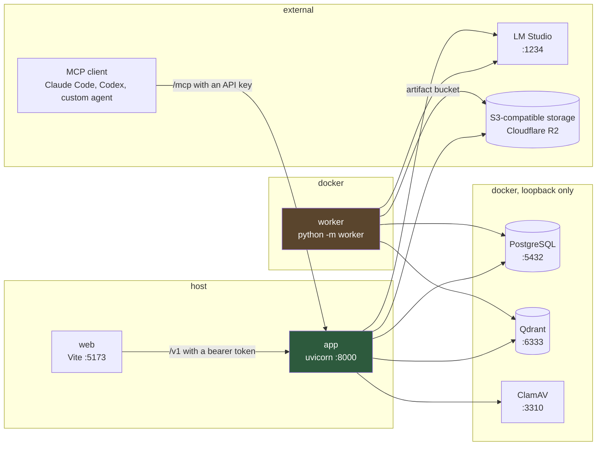
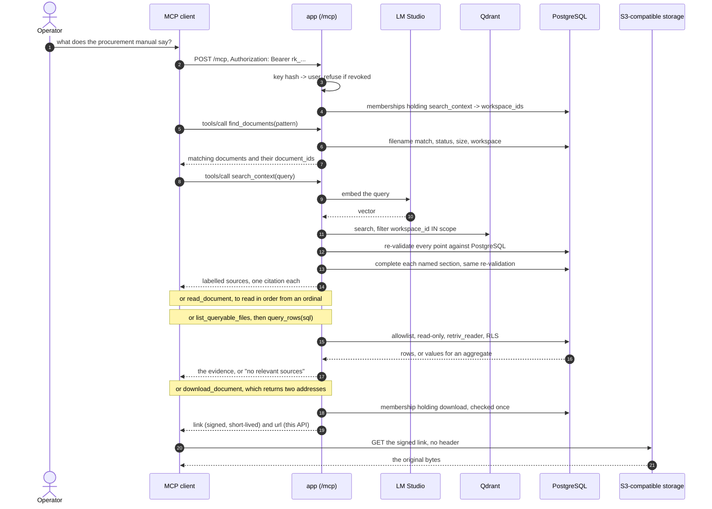
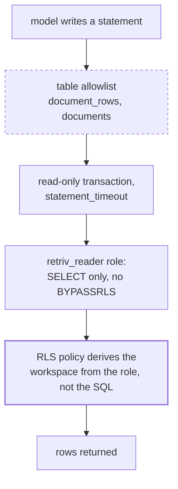
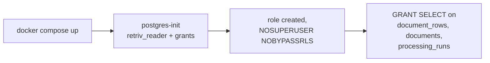
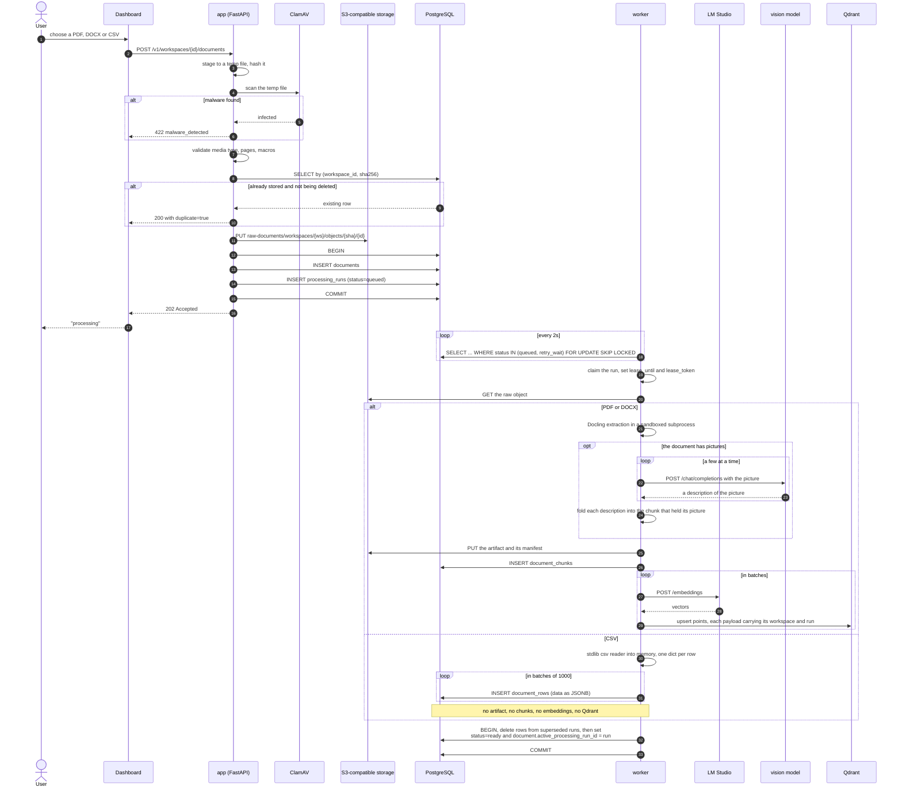
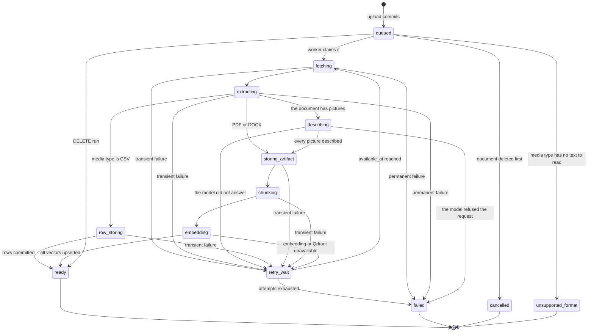
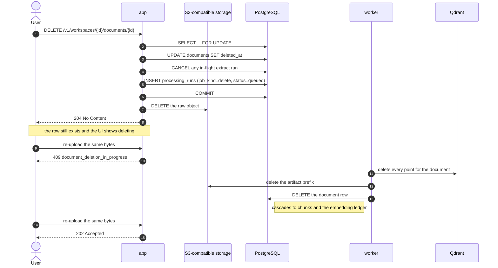
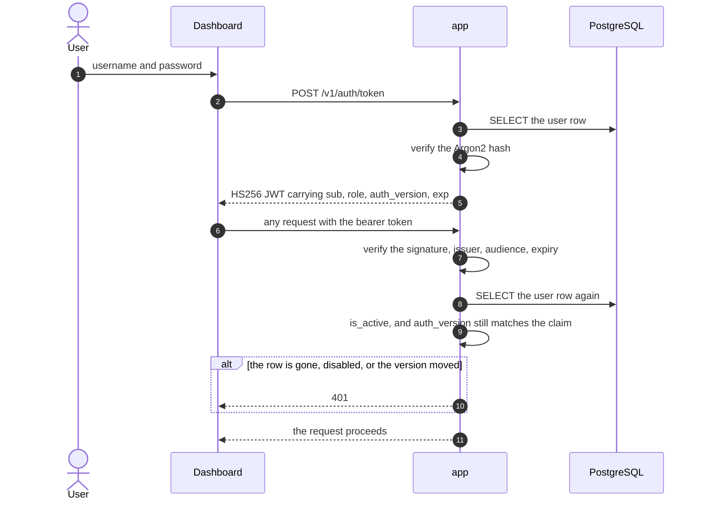
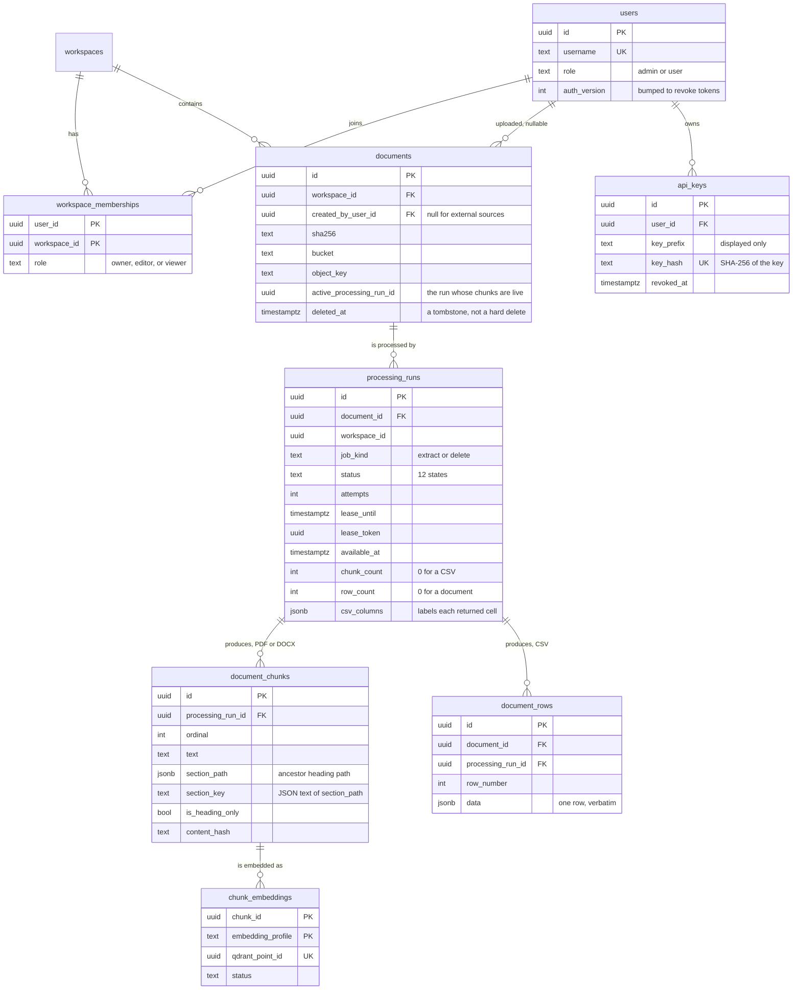

# Retriv

Backend untuk menerima dokumen perusahaan dengan scope per workspace, mengindeksnya, dan
menyajikannya sebagai tool MCP: `find_documents` untuk mencari berkas, `search_context`
untuk prosa, `query_rows` untuk CSV, `download_document` untuk berkas aslinya.

Satu aplikasi. Satu database. Satu entrypoint lain: worker pemrosesan.

```
app/          the HTTP application: auth, documents, processing status, the MCP server
worker/       the extraction worker: Docling, chunking, embedding (separate process)
alembic/      one migration history, one database
web/          the dashboard
```



Solid arrows are the only thing crossing a process boundary now, and all of them point
at infrastructure. The two application processes reach each other through `app/`'s own
imports.

## Why one application

It used to be three services with their own databases, talking over HTTP. That bought a
lot of machinery for no benefit: a shared token, an HMAC-signed webhook, a transactional
outbox, an event inbox, an RS256 scope keypair, and a read-only database role — all to let
one process call another on the same host. Roughly sixteen environment variables whose
only job was to prove the caller was who it said it was.

The answer path is still scoped. A question is answered only from workspaces the caller
has `search_context` on, and the retriever re-checks that against every Qdrant point and
every PostgreSQL row. What changed is that the scope is now a function argument derived
from the caller's own memberships, rather than a token that had to be signed and
verified.

The worker stays a separate process for a concrete reason: Docling and PyTorch need
about 1.7 GB, an 8 GiB parser memory cap, and a sandboxed subprocess per document. Keeping
that in its own container is what keeps the API image around 250 MB and keeps a hostile
PDF away from the request path.

## Scope

- JWT access tokens valid for 60 minutes.
- The first admin is created from `RETRIV_BOOTSTRAP_ADMIN_*` on startup; later users by a
  platform admin.
- `admin` is a platform role for the dashboard and grants no workspace data access.
- Workspace access lives in a membership table with role `owner`, `editor`, or `viewer`.
- Every authenticated user can see the workspace catalogue; document data requires a
  matching membership.
- Identical bytes in the same workspace are deduplicated by SHA-256.
- Uploads default to 50 MiB and 500 pages; encrypted and macro-enabled documents are
  rejected, and ClamAV scans before anything is stored.
- `PDF` and `DOCX` are chunked and embedded. `CSV` is stored as rows and queried with
  SQL; it is never embedded. `XLSX` is not accepted at all, because nothing could read
  it.
- A document's status is derived from its active processing run. There is no status
  column, so the document and the pipeline cannot disagree.

## Prerequisites

- Docker Engine and Docker Compose v2.
- `uv` for local test/lint, or Python 3.12+.
- An OpenAI-compatible embedding server on `127.0.0.1:1234` that is reachable from the
  worker container.
- An OpenAI-compatible endpoint for a multimodal model, to describe the pictures in a
  document. Without one, set `RETRIV_IMAGE_PROCESSING_ENABLED=false` and the pictures
  are simply not described.
- An S3-compatible object storage account with two buckets already created: one for raw
  documents and one for extracted artifacts. This deployment targets Cloudflare R2, but
  any S3-compatible provider works.
- About 4 GiB of RAM for ClamAV on first startup.

## Running locally

```bash
cp .env.example .env
```

Fill in every `CHANGE ME`; the generated ones are `openssl rand -hex 32`. The object
store comes first: create both buckets and the two scoped tokens described below, then
fill in the endpoint and keys. Uploads, indexing, and retrieval work once those and the
stack are up. The other exception is the vision endpoint, which is where the pictures in
a document are described — point it at a gateway that speaks the OpenAI chat API, or
switch the stage off with `RETRIV_IMAGE_PROCESSING_ENABLED=false`.

```bash
make migrate   # start infrastructure and apply the schema
make api       # start the worker, then run the API on :8000
```

`make api` builds and starts the worker in Docker, so the first run takes a while: the
image is ~1.7 GB and the Docling layout and tableformer models are downloaded into it.

The dashboard is a separate npm project:

```bash
cd web && npm ci && npm run dev
```

It is at `http://127.0.0.1:5173`.

ClamAV's first start downloads its signature database and can take a few minutes.
PostgreSQL, Qdrant, and ClamAV publish on loopback only.

## Object storage

The API writes raw uploads, the worker reads them and writes extracted artifacts. Both
buckets must exist before the stack starts; the application never creates them.

| Provider | Endpoint | Region | Addressing | Credentials |
|---|---|---|---|---|
| Cloudflare R2 | `https://<account_id>.r2.cloudflarestorage.com` | `auto` | `path` | two bucket-scoped `Object Read & Write` tokens |
| AWS S3 | leave empty | the bucket's region | `auto` or `virtual` | an IAM user access key/secret |
| Other S3-compatible | provider endpoint | provider region | provider-dependent | access key/secret |

For R2, create the buckets in the dashboard or with Wrangler, then create two Account API
tokens:

- **API token** — `Object Read & Write`, applied only to the raw bucket.
- **Worker token** — `Object Read & Write`, applied to the raw and artifact buckets. R2
  scopes permissions per bucket and cannot express prefix-level policies, so the worker
  token is deliberately the practical choice: it can write both buckets.

`RETRIV_S3_ACCESS_KEY` is the API identity and `RETRIV_S3_ARTIFACT_ACCESS_KEY` is the
worker identity. Both buckets use the same endpoint, so there is no separate
container-only endpoint setting.

## Data

The local stack's state is in Docker named volumes under the `retriv-api` project:

- `retriv-api_postgres_data`
- `retriv-api_qdrant_data`
- `retriv-api_clamav_data`

Nothing is bind-mounted. `docker compose down` keeps the data; `docker compose down -v`
deletes all of it.

## Asking a question over MCP

Retrieval is served as MCP tools at `/mcp` (streamable HTTP, mounted in the same
FastAPI app). A client -- Claude Code, Codex, or anything that speaks the protocol --
keeps `Authorization: Bearer rk_...` on every request. The key identifies a user; the
workspaces it can see are derived live from that user's memberships, so demoting or
removing the user narrows the next call rather than the next login.

The tools are `find_documents`, `search_context`, `read_document`,
`list_queryable_files`, `query_rows`, and `download_document`. `query_rows` is registered only
when `RETRIV_SQL_DATABASE_URL` is set: an absent tool is something a model stops trying,
whereas a tool that always answers "not enabled" is one it keeps retrying.

Nothing here writes. Upload, status and deletion live in the HTTP API and the dashboard,
because they are decisions a person takes rather than ones a model should reach for
unprompted. An API key is therefore read-only: a leaked one exposes documents the holder
could already search, and can destroy nothing.

A turn has two possible doors into the documents. `search_context` retrieves prose by
meaning; `query_rows` runs SQL over tabular rows. The client's model picks, which is
why `list_queryable_files` exists and why the CSV catalogue is repeated inside the row
tool's reply. Reading a document in order rather than by relevance is a third move,
`read_document`, and it is described below.

`find_documents` is the door in rather than the way out: it maps a name to a
document_id. Without it a model can only learn an id from a search result or the CSV
catalogue, so naming a file in a question is not something it can act on. It reports
each match's status, because `ready` is the difference between a document that answers
a question and one that returns nothing yet, and each match's size and workspace,
because **filenames are not unique** -- only content is, per workspace, so two revisions
of one document both appear and have to be told apart by the caller.

`download_document` is the way out to the file itself, and it is worth understanding what
it deliberately does not do: it returns addresses and metadata, never the bytes. A tool
result is what lands in the model's context, so a 566 KB PDF delivered as a result is
roughly 189k tokens of base64 in the prompt. Instead it returns two ways to fetch the
file:

| Field | Points at | Needs a header | Permission re-checked |
|---|---|---|---|
| `link` | the object store, signed | no | once, when minted |
| `url` | this API's `/download` route | yes, the same API key | on every request |

`link` is a SigV4 presigned GET, valid for `mcp_download_link_ttl_seconds` (default 300,
capped at an hour). It needs no credential at all, which is what makes it usable as a
plain click, and it points straight at the configured S3-compatible endpoint -- the
request never touches this process again. The cost is that it is a bearer credential
which **cannot be revoked before it expires**, so the `download` permission is checked
once when it is minted and the window is kept short on purpose. `url` is the conservative
alternative: slower (bytes stream through the API) but revocable, and it works anywhere
the API is reachable.

Because `link` names the object store directly, whoever receives it must be able to
reach that endpoint. For R2 that is
`https://<account_id>.r2.cloudflarestorage.com`, which is public TLS already. The cost is
that the bucket is now reachable from wherever the agent runs, so the link's TTL is the
only bound on a leaked address.

The secret key never appears in a signed URL -- only the access key ID does, which is an
identifier rather than a credential, and the token's bucket scope is what actually
bounds it.



Four things keep this honest:

1. **The scope is derived from the caller's own membership table**, not from a
   client-supplied list. Naming a `workspace_id` can only narrow the set the key
   already had; it cannot widen it, and the refusal is the same for "not yours" and
   "does not exist".
2. **The `search_context` tool accepts a query and nothing else.** A model has no
   argument with which to argue for a wider scope.
3. **Every Qdrant point is re-validated against PostgreSQL**, including a recomputed
   `content_hash`. A vector whose chunk is gone, stale, or from a superseded run never
   reaches the client.
4. **`RowQuery` re-checks the result on the way out.** Every row it returns must carry
   the one `document_id` the statement was written against; a result spanning two files
   is refused rather than rendered.

The key is checked twice on purpose. The endpoint middleware answers "is this a live
credential?" before a byte of the JSON-RPC body is read, and every tool re-derives the
caller from its own request headers, because tool handlers run in the session manager's
task group rather than in the HTTP request that carried them. Revoking a key therefore
takes effect on the next call, not at the end of a session.

### How a heading gets its content back

Docling chunks a document by its own structure, not by a fixed window: a section that
fits becomes one chunk, a longer one splits, and every chunk carries the full ancestor
heading path (`section_path`) both as a column and prepended to its text. Retrieval is
where that structure is spent.

A heading is short and topically concentrated, so against a vague query it outscores the
prose it introduces. On a 57-page regulation, "Article 16: General framework" matched at
0.81 while Regulation 16.01-16.06 did not appear at all, and the agent reported the
article's content as absent from a document that contained it.

The repair is not to return the next few chunks in reading order -- the content is
rarely adjacent. When Docling meets a heading followed by numbered sub-provisions, it
files the prose under paths that *end* in the sub-number, so the heading's own key is
held by a single short chunk and the substance sits at deeper keys. So a search completes
each section it names: the anchor's own chunks, then its sub-sections, capped at
`section_expand_chunks` per section and `max_context_sources` in total.

Two details are load-bearing:

- **`max_context_sources` must exceed `max_context_chunks`.** `limit` bounds similarity
  matches; the budget bounds the total. Without a budget the cap collapses onto `limit`,
  and a search that filled its quota has nowhere to put a completion -- which is exactly
  the case completion exists to serve. Every baseline recorded before this was corrected
  reports `expansion_only_hits: 0`, because the feature was unreachable.
- **Subtree matching is on the key, not on the heading text.** `section_key` is the JSON
  text of `section_path`, so a closing bracket followed by a comma marks a descendant
  exactly: the subtree of `Pasal 16` cannot swallow `Pasal 160`. PostgreSQL cannot slice
  `jsonb` (`jsonb subscript does not support slices`) and the jsonpath spelling
  `$[0] == "..."` matches far more than the prefix it names, which is why the key is a
  column in its own right, indexed with `text_pattern_ops`.

Completed rows are not backed by a Qdrant match, so every guarantee in
`VALIDATE_CHUNKS` is repeated for them: workspace scope, non-deleted document, active
processing run, indexed embedding, and a recomputed `content_hash`.

### Reading a document in order

Completion repairs a search that lands on a heading. It does not answer the next question,
which is what the text *around* a passage says. That is the other axis, and it is the one
a vector search structurally cannot serve: nothing in an embedding knows what follows
anything. `ordinal` is a chunk's position in reading order within one processing run, so a
window over it is a contiguous slice -- the text after a hit, the rest of a section, or a
document read through from the top.

| | Axis | Answers |
|---|---|---|
| `search_context` | `section_key`, hierarchical | "what is section X?" |
| `read_document` | `ordinal`, positional | "what comes after this chunk?" |

The two compose, and the bridge between them is a number: every source label carries the
`ordinal` it sits at, so a search hit hands the reader exactly the argument
`read_document` needs. A hit that is only a title is also marked `kind=heading`, and the
search reply says so explicitly -- otherwise the reader takes a bare heading as evidence
that the document is silent on the subject, which is the exact misreading completion
exists to prevent.

The hint is conditional on a heading actually being in the results. Shown on every search
it would be background noise within two calls, and a reader taught to ignore it cannot be
taught anything by the version that matters.

The window is bounded by `navigation_token_budget`, not by a chunk count. Chunk sizes in
this corpus run from 5 tokens for a bare heading to the 700-token ceiling, so any fixed
count is either wasteful on a short-headed document or explosive on a dense one; 8,000
tokens is about 80 chunks of the regulations and about a dozen of a dense annual report.
The reply always states how many chunks the document has and where to resume, so a
truncated window cannot be mistaken for the whole document. A single chunk over budget is
still returned, because trimming it would return nothing and every retry from the same
`start_ordinal` would trim it again -- a window that can never advance.

CSV files are refused here rather than handled: a CSV is stored as rows, not chunks, so the
failure names `list_queryable_files` and `query_rows` instead of reading as a fault.

### Asking a spreadsheet question

`query_rows` is a different door into the data, and it is worth being precise about what
protects it. The statement is written by the model, so it is not the argument validation
that keeps it in bounds — four layers below it do:



The dashed layer is the weakest one and is not what isolates anything. Deleting the
allowlist would not let the model read a table it lacks a grant on; the model cannot
issue `SET`, cannot open a transaction, and cannot write. What the allowlist does remove
is a table that is *granted* but should not be *mentioned* — `processing_runs` carries
`lease_token` and `last_error`, so the wrapper reads it to learn a file's columns while
the model cannot name it at all.

`verify_reader()` refuses to run if the configured role turns out to be `SUPERUSER` or to
hold `BYPASSRLS`, which would make every layer above irrelevant.

### Where the reader role comes from

`FORCE ROW LEVEL SECURITY` is on all three tables and `verify_reader()` refuses a role that
could ignore it. The role itself is created by `postgres-init`, a one-shot compose service that runs on
`docker compose up`:



This was a documented manual `CREATE ROLE` once, and that turned out to be the worst
possible place for it. Migrations `0002` and `0003` grant to the role **only if it already
exists** — a password must never land in a migration, so a GRANT against a role that was
never created aborts the whole upgrade. Skipping the manual step therefore produced a
deployment that migrated cleanly, was configured cleanly, and then refused to start, with
nothing in the output naming the step that was missed.

The script is idempotent and applies the grants itself rather than relying on migration
order, so both directions work: a fresh volume gets its tables from `alembic` and its
grants from the script, an existing volume gets both repaired. It also re-asserts
`NOSUPERUSER NOBYPASSRLS` and resets the password on every run, so rotating the secret in
`.env` takes effect on the next `compose up`, and a role promoted by hand is demoted rather
than quietly keeping privileges the policies do not constrain.

`make sql-role` runs just this step. It is the recovery path for a dropped role, and it is
also wired into `make api`, which otherwise does not go through `infra` and would leave a
developer on a fresh clone with a failure whose cause is a service they never named.

Point `RETRIV_SQL_DATABASE_URL` at that role, not at the application DSN: the tool works
against a full-privilege connection, but then nothing above is doing any work. Leaving it
unset is the safe default — the tool is never registered and the model cannot reach a
table, while the catalogue still lists the files through the app's own session so it can
tell the user the data exists but is not queryable.

The password exists twice by necessity — the script creates the role with
`RETRIV_SQL_READER_PASSWORD`, and asyncpg authenticates with the copy inside the DSN — and
nothing interpolates between them. The settings layer compares the two at startup, because
the alternative is a deployment that fails in `verify_reader()` with a message blaming the
DSN rather than the value that actually disagrees with it.

```bash
make sql-role   # create or repair the role and its grants
```

Two rules keep a query from silently answering a question about the wrong file. A query
must mention a `document_id` literal, and rows returning more than one `document_id` are
rejected. Aggregates return no rows, so they are exempt from the second check and the
literal check is the only guard — a query using `ANY(array[...])` over two ids would
slip past it. That gap is real and still open; a fix would parse the id out of the
statement rather than searching its text.

### How a CSV answer is cited

An aggregate has no row to point at, so it cannot be cited the way a quoted line is.
`query_rows` reports it as values and says so outright -- "these values are computed from
the rows, so there is no single row to cite" -- so a count is never dressed up as a
quotation. Row results are the opposite: each row becomes one source, and two files
still yield two sources, because they are different evidence.

A source is located by page if it has one and by nothing if it does not. Every CSV row
carries `pages=unknown`, for the plain reason that a row has no page and inventing one
would make a citation point at the wrong place.

## How a document becomes searchable



A CSV takes the rows path, not the chunk path. It is tabular data the model will
aggregate rather than prose it will quote, so it is stored verbatim as JSONB and
queried with SQL. Nothing is embedded, which is why the run reports `row_count = 320`
rather than a chunk count.

A document cannot exist without a way to be processed: the row and the run commit
together or not at all. There is no outbox and no retry-on-replay, because there is no
network hop where an event could be lost.

The run is not a signal — the worker **polls** every 2 seconds. `LISTEN`/`NOTIFY` was
rejected on purpose: the payload limit is 8 KB, the notification is delivered at commit
and is lost forever with no reader, so you would end up running both mechanisms anyway.

### The run state machine



A lease is held for 30 minutes and heartbeated every third of that. A run whose lease
expired is reclaimed by the next worker, which is what makes a worker crash recoverable
without a coordinator. Transient failures back off exponentially, capped at 300s.

### The pictures in a document

A PDF can carry information that no text layer holds. A chart's values, a diagram's
arrows, a photograph's subject: they are pixels, and the parser sees them as pixels.
A question about what a chart says has nothing in the document to match against, and
the answer is that the document does not say it — which is not true.

So the pictures are described, and the description is put where the picture was.

Docling's layout model already tells a figure apart from a logo, a rule and page
furniture, and crops the figure out of the page on its own. The pipeline asks it to
keep those crops (`generate_picture_images`), and the chunking serializer writes each
picture into its chunk as a marker naming it — Docling's own serializer writes a
picture as an empty string, which drops it from the chunk entirely. The marker is
what lets the description land on the line the picture was on, in the section the
picture was in, between the sentences that talk about it:

```
3.2 Financial Performance
The chart shows net revenue by segment for fiscal 2015.
[Image description: A bar chart with three vertical bars. 2013: 1,234. 2014: 1,456. 2015: 1,789.]
Figure 1: Net revenue by segment (in millions).
Revenue grew across all three reported segments during the year.
```

That chunk is then embedded by the same text embedding model as everything else, so a
question about the chart's numbers finds the paragraph that talks about the chart.

The model is a multimodal one behind an OpenAI-compatible API (`RETRIV_VLM_BASE_URL`,
`RETRIV_VLM_API_KEY`, `RETRIV_VLM_MODEL`). The picture is sent as a `data:` URL, so
it goes nowhere except to the model that is going to describe it. The response's
model id is checked against the one that was asked for: a gateway that answers with
a different model has not done what was asked, and the answer is refused rather than
indexed.

**The stage fails the run rather than skipping the pictures.** A document indexed
without its figures is a document that looks complete and is not, and nothing
downstream can tell the difference. A timeout or a rate limit is retried, within the
budget `RETRIV_MODEL_WAIT_*` sets; a key the endpoint refuses fails the run outright,
because retrying that only delays the report that the deployment is misconfigured.

**The model is allowed to think.** `RETRIV_VLM_MAX_TOKENS` is a ceiling on the
model's whole answer, reasoning included — not a limit on how long it may think. A
reasoning model stops on its own well below a generous ceiling (the busiest chart in
the 10-K spent about 2,200 tokens thinking before it wrote a word). The ceiling only
matters when it is set *below* what the model wanted, because then the endpoint cuts
it off mid-thought and hands back nothing. In that case the budget goes up and the
same picture is asked again, up to `RETRIV_VLM_MAX_TOKENS_CEILING` — the model was
not finished describing the picture, it was cut off, and the picture is not failed
over a question of budget. The gateway's `reasoning_effort` is left alone: thinking
less would make the descriptions worse, which is the opposite of the point.

Three settings decide what is worth describing:

| setting | what it does |
|---|---|
| `RETRIV_IMAGE_PROCESSING_ENABLED` | off means the parser is not even asked to render pictures, and the document is indexed exactly as it was before this stage existed |
| `RETRIV_IMAGE_MIN_PIXELS` | pictures whose rendered area is below this are dropped: at that size they are logos, rules and ornaments |
| `RETRIV_VLM_MAX_IMAGES_PER_DOCUMENT` | how many pictures of one document may cost an API call; 0 means no cap |

The pictures are described in the worker, never in the extraction sandbox. The sandbox
is a jail for a hostile parser: it has a scrubbed environment, no network, and no
reason to hold an API key.

## Deleting a document

The ordering is the whole point.



The Qdrant point IDs live in `chunk_embeddings`, which cascades away with the document.
Deleting the row first would orphan every vector the document ever produced, with no
record of where to find them. So the row outlives the request and dies last.

While the cleanup is in flight the `(workspace_id, sha256)` unique constraint still
holds the row, which is why an identical re-upload is refused rather than silently
creating a duplicate.

## Authentication and revocation



`auth_version` is the reason a password reset or a bootstrap-admin password change takes
effect immediately rather than at token expiry: the claim is compared against the row on
every request, so bumping the counter invalidates every outstanding token at once. The
`admin` platform role is orthogonal to workspace roles and grants no data access.

API keys are a second, longer-lived credential for the same user. One is created from the
dashboard, shown in plaintext exactly once, and stored as a SHA-256 hash alongside a short
display prefix -- nothing on disk can be turned back into a usable key. No scope is stored
on the key: the workspaces it reaches are read from the owning user's memberships on every
request, so demoting the user, disabling them, or revoking the key each narrow the next
tool call on their own.

A key reaches exactly two things: `/mcp`, and the one HTTP route `download_document`
points at -- `GET /v1/workspaces/{id}/documents/{id}/download`, which is why that route
accepts a key where every other route still requires the dashboard's JWT. It exists so an
agent can fetch the bytes a tool pointed it at without the file passing through the model.
That is the entire blast radius: an agent key can read and download, and reaches no write
endpoint, no other user's data, and nothing outside the holder's workspaces.

The signed `link` the tool hands out is a third thing a holder of a document's address can
do, and it is deliberately weaker than the key: it names one object, cannot be narrowed,
and dies on its own. Revoking the key does not revoke a link already issued, which is
the one guarantee an operator cannot have here.

## The first admin

A fresh deployment has no users and no self-registration. The API creates the first
platform administrator on startup from `RETRIV_BOOTSTRAP_ADMIN_USERNAME` and
`RETRIV_BOOTSTRAP_ADMIN_PASSWORD`:

- the account is created only when the username does not exist;
- the password is kept in sync with the environment; if it changed, the hash is
  replaced and `auth_version` is bumped, signing out sessions issued under the old
  password;
- role and active flag are left alone, so disabling the account is not undone by a
  restart;
- leave both variables empty when the deployment already has its users.

The admin can create workspaces and assign their first owner through `/v1/admin`:
`POST /v1/admin/workspaces` and `PUT /v1/admin/workspaces/{id}/members/{user_id}`.

## The shape of the data



`documents.status` does not exist. It is derived from `active_processing_run_id`'s run,
in one function, which is why the document and the pipeline cannot disagree.

A document has either `document_chunks` or `document_rows`, never both, and the run
carries the count that says which: `row_count = 320` for a CSV, `chunk_count = 412` for
a PDF. `csv_columns` sits on the run rather than on every row because it labels each
returned cell, and repeating a header across 100k rows is the cost this design avoids.

`document_rows.data` is JSONB and read with `->>`, which is why a SQL error saying
`column "year" does not exist` comes back to the model as a hint naming `data->>'Year'`
rather than as a failure. The tool translates the error rather than replaying it,
because the model can fix the second query and cannot fix a bare failure.

## Development

```bash
make check     # pytest, ruff, mypy
```

`tests/test_postgres_integration.py` covers the things SQLite cannot show —
concurrent identical uploads racing on a unique constraint, foreign-key ordering, RLS
against a real `retriv_reader`, and the full CSV path from HTTP upload through storage
and the worker to a queryable row. It skips unless `TEST_POSTGRES_URL` is set.

Two tests there currently fail and are unrelated to CSV: the concurrent-upload race can
observe a rolled-back duplicate, and one assertion still expects `RUN_CHUNKING` where the
worker now sets `RUN_EMBEDDING` directly.

Tests here are checked by mutation as well as by passing. A test that stays green when
the behaviour it names is reverted is worse than no test, so the citation rules in
particular are verified by reverting each one — a per-row `chunk_id`, `section_path`
repopulated with column names, a dangling separator beside an empty locator — and
confirming the suite fails.
