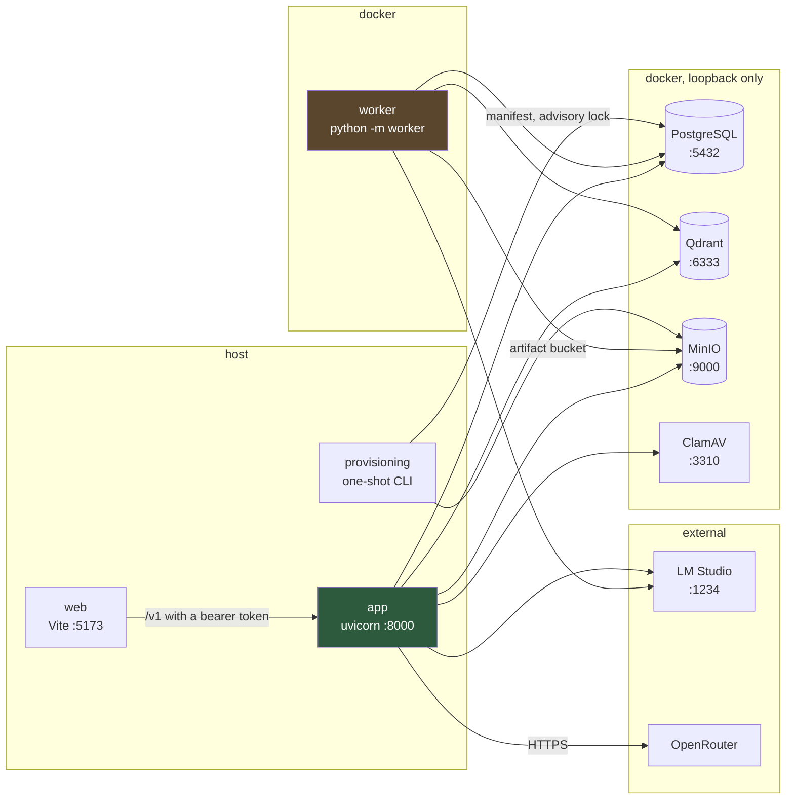
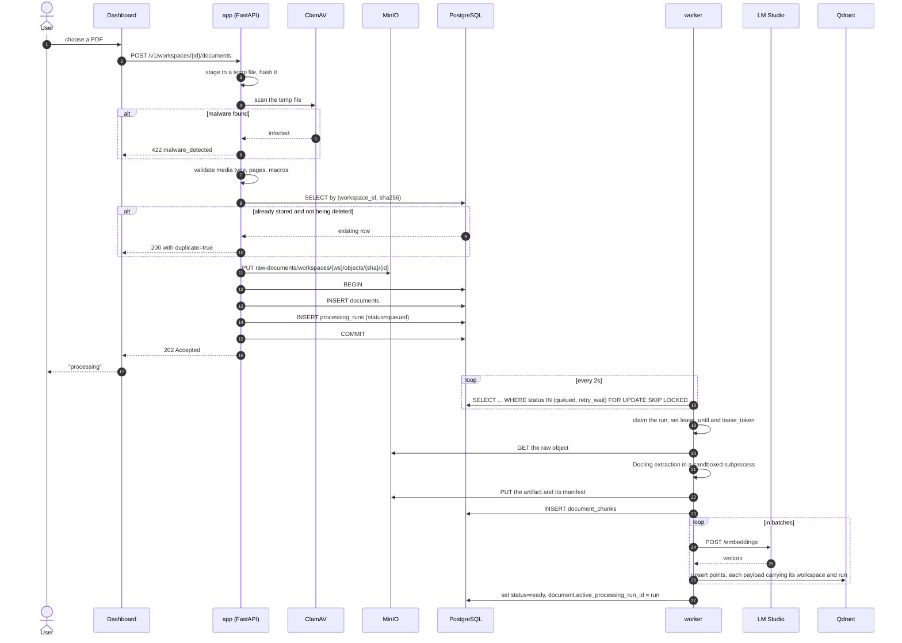
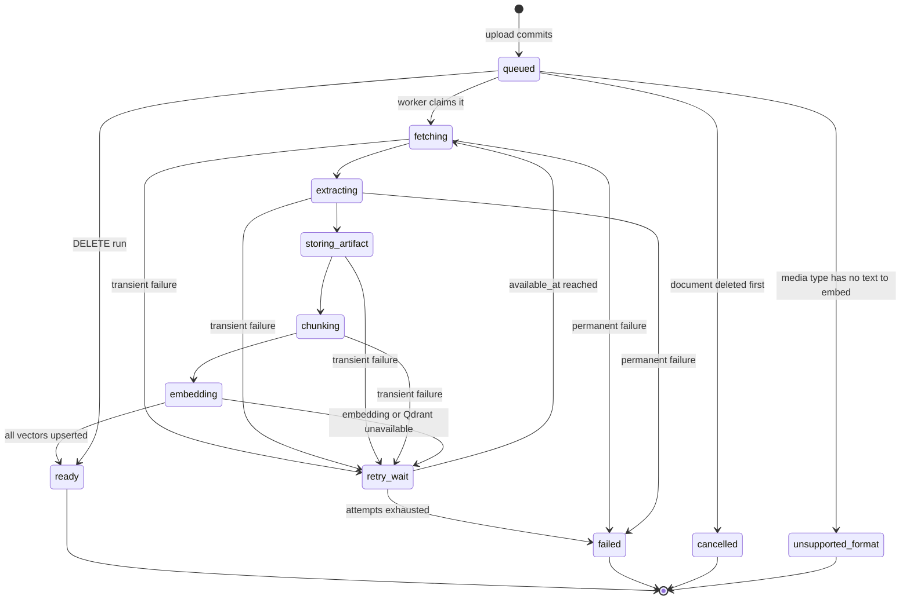
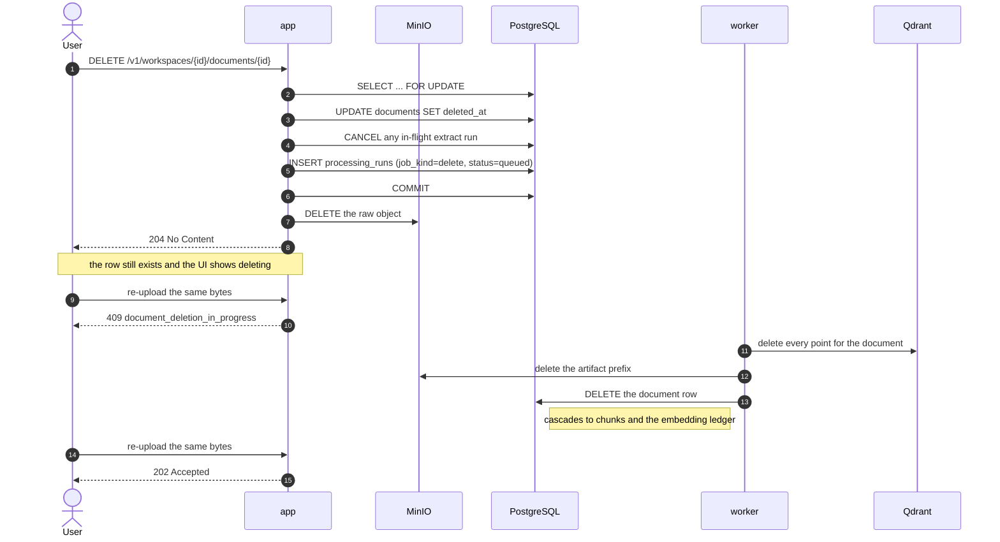
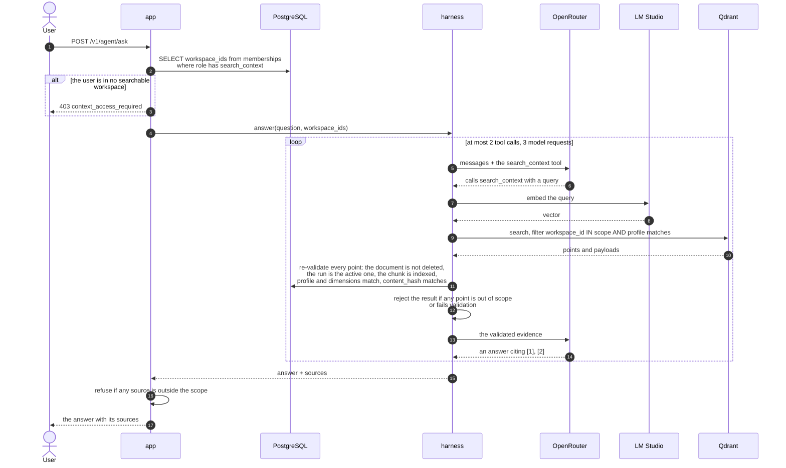
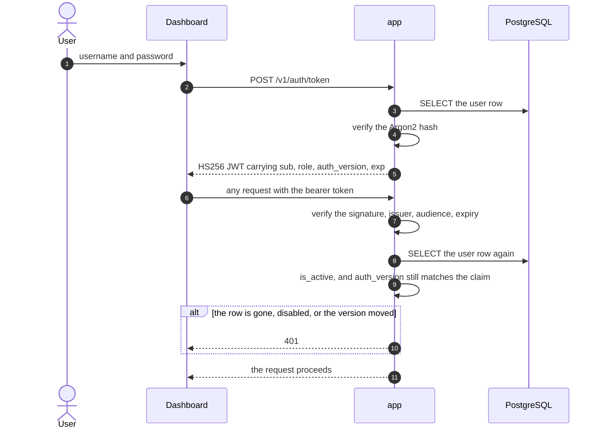
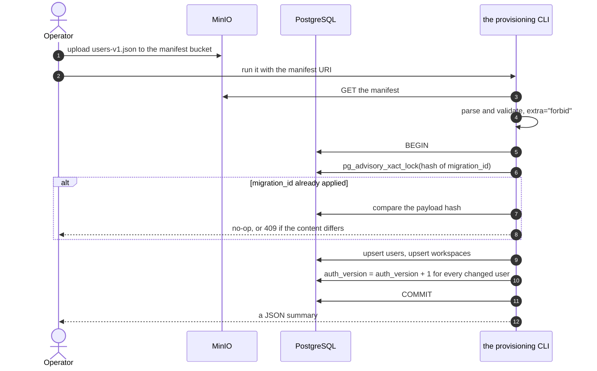
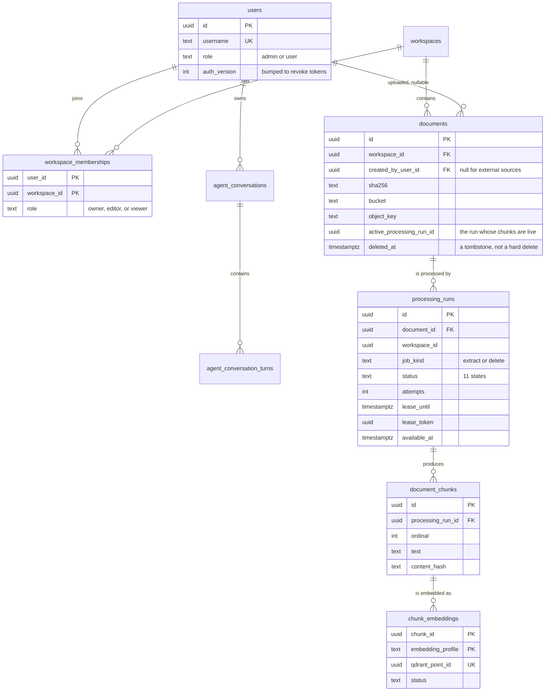

# Retriv

Backend untuk menerima dokumen perusahaan dengan scope per workspace, mengindeksnya, dan
menjawab pertanyaan di atasnya.

Satu aplikasi. Satu database. Dua entrypoint lain: worker pemrosesan dan provisioning.

```
app/          the HTTP application: auth, documents, processing status, answers
worker/       the extraction worker: Docling, chunking, embedding (separate process)
provisioning/ the one-shot CLI that creates the first users and workspaces
alembic/      one migration history, one database
web/          the dashboard
```



Solid arrows are the only thing crossing a process boundary now, and all of them point
at infrastructure. The three application processes reach each other through `app/`'s own
imports.

## Why one application

It used to be three services with their own databases, talking over HTTP. That bought a
lot of machinery for no benefit: a shared token, an HMAC-signed webhook, a transactional
outbox, an event inbox, an RS256 scope keypair, and a read-only database role — all to let
one process call another on the same host. Roughly sixteen environment variables whose
only job was to prove the caller was who it said it was.

The answer path is still scoped. A question is answered only from workspaces the caller
has `search_context` on, and the retriever re-checks that against every Qdrant point and
every PostgreSQL row. What changed is that the scope is now a function argument derived
from the caller's own memberships, rather than a token that had to be signed and
verified.

The worker stays a separate process for a concrete reason: Docling and PyTorch need
about 1.7 GB, an 8 GiB parser memory cap, and a sandboxed subprocess per document. Keeping
that in its own container is what keeps the API image around 250 MB and keeps a hostile
PDF away from the request path.

## Scope

- JWT access tokens valid for 60 minutes.
- The first users are created by a one-shot provisioning manifest; later users by a
  platform admin.
- `admin` is a platform role for the dashboard and grants no workspace data access.
- Workspace access lives in a membership table with role `owner`, `editor`, or `viewer`.
- Every authenticated user can see the workspace catalogue; document data requires a
  matching membership.
- Identical bytes in the same workspace are deduplicated by SHA-256.
- Uploads default to 50 MiB and 500 pages; encrypted and macro-enabled documents are
  rejected, and ClamAV scans before anything is stored.
- `PDF` and `DOCX` are indexed. `XLSX` is stored and retrievable as a file but has no
  text to embed, so its run ends immediately in `unsupported_format` rather than sitting
  on "processing" forever.
- A document's status is derived from its active processing run. There is no status
  column, so the document and the pipeline cannot disagree.

## Prerequisites

- Docker Engine and Docker Compose v2.
- `uv` for local test/lint, or Python 3.12+.
- An OpenAI-compatible embedding server on `127.0.0.1:1234` that is reachable from the
  worker container.
- An OpenRouter key for answers.
- About 4 GiB of RAM for ClamAV on first startup.

## Running locally

```bash
cp .env.example .env
```

Fill in every `CHANGE ME`. The only one that cannot be generated for you is the OpenRouter
key; the rest are `openssl rand -hex 32`. Until the chat key and model are set, uploads
and indexing work and questions return a provider error.

```bash
make migrate   # start infrastructure and apply the schema
make api       # start the worker, then run the API on :8000
```

`make api` builds and starts the worker in Docker, so the first run takes a while: the
image is ~1.7 GB and the Docling layout and tableformer models are downloaded into it.

The dashboard is a separate npm project:

```bash
cd web && npm ci && npm run dev
```

It is at `http://127.0.0.1:5173`.

ClamAV's first start downloads its signature database and can take a few minutes.
PostgreSQL, Qdrant, MinIO, and ClamAV publish on loopback only.

## Data

Everything is in Docker named volumes under the `retriv-api` project:

- `retriv-api_postgres_data`
- `retriv-api_qdrant_data`
- `retriv-api_minio_data`
- `retriv-api_clamav_data`

Nothing is bind-mounted. `docker compose down` keeps the data; `docker compose down -v`
deletes all of it.

## How a document becomes searchable



A document cannot exist without a way to be processed: the row and the run commit
together or not at all. There is no outbox and no retry-on-replay, because there is no
network hop where an event could be lost.

The run is not a signal — the worker **polls** every 2 seconds. `LISTEN`/`NOTIFY` was
rejected on purpose: the payload limit is 8 KB, the notification is delivered at commit
and is lost forever with no reader, so you would end up running both mechanisms anyway.

### The run state machine



A lease is held for 30 minutes and heartbeated every third of that. A run whose lease
expired is reclaimed by the next worker, which is what makes a worker crash recoverable
without a coordinator. Transient failures back off exponentially, capped at 300s.

## Deleting a document

The ordering is the whole point.



The Qdrant point IDs live in `chunk_embeddings`, which cascades away with the document.
Deleting the row first would orphan every vector the document ever produced, with no
record of where to find them. So the row outlives the request and dies last.

While the cleanup is in flight the `(workspace_id, sha256)` unique constraint still
holds the row, which is why an identical re-upload is refused rather than silently
creating a duplicate.

## Asking a question



Four things keep this honest, and all four survive the merge:

1. **The scope is derived from the caller's own membership table**, not from a
   client-supplied list. There is no signed token to forge, because there is no second
   service to receive one.
2. **The `search_context` tool accepts a query and nothing else.** A model has no
   argument with which to argue for a wider scope.
3. **Every Qdrant point is re-validated against PostgreSQL**, including a recomputed
   `content_hash`. A vector whose chunk is gone, stale, or from a superseded run never
   reaches the model.
4. **The route re-checks the sources on the way out.** Reaching that check means the
   harness itself drifted, so the whole answer is refused rather than returned in part.

A turn that cited a workspace the caller has since lost stays visible in their private
transcript, but its sources are blanked and it is never replayed as context. Greeting-only
messages skip retrieval entirely, so a user with no workspace can still say hello.

## Authentication and revocation



`auth_version` is the reason a password reset or a provisioning change takes effect
immediately rather than at token expiry: the claim is compared against the row on every
request, so bumping the counter invalidates every outstanding token at once. The
`admin` platform role is orthogonal to workspace roles and grants no data access.

## Provisioning



Two things to know before you use it:

- **It creates workspaces with no members.** Assigning the first owner is an admin API
  call: `PUT /v1/admin/workspaces/{id}/members/{user_id}`. A provisioned workspace is
  otherwise unreachable.
- **It overwrites credentials.** A username that already exists has its password hash,
  role, and active flag reset from the manifest, and its `auth_version` bumped, so every
  live session for that user is signed out.

## The shape of the data



`documents.status` does not exist. It is derived from `active_processing_run_id`'s run,
in one function, which is why the document and the pipeline cannot disagree.

## Development

```bash
make check     # pytest, ruff, mypy
```

`tests/test_postgres_integration.py` covers the two things SQLite cannot show —
concurrent identical uploads racing on a unique constraint, and foreign-key ordering. It
skips unless `TEST_POSTGRES_URL` is set.
